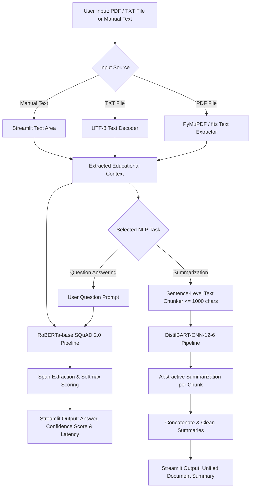

<div align="center">

# 🎓 Educational NLP Assistant
### *Intelligent Document Question Answering & Abstractive Summarization with Small Language Models (SLMs)*

[](https://www.python.org/)
[](https://streamlit.io/)
[](https://huggingface.co/)
[](https://pytorch.org/)
[](LICENSE)
[]()

<p align="center">
  <b>A lightweight, privacy-friendly, and cost-effective NLP study companion designed for students and educators.</b><br>
  Extract precise answers, summarize research papers, and interact with study materials with sub-second inference on standard hardware.
</p>

[Key Features](#-key-features) •
[Architecture](#-system-architecture) •
[Models Used](#-models--specifications) •
[Installation & Usage](#-getting-started) •
[Evaluation & Screenshots](#-benchmarks--screenshots) •
[Project Structure](#-project-structure)

</div>

---

## 📖 Overview

Modern Large Language Models (LLMs) provide impressive reasoning capabilities, but they often require expensive cloud API calls, high-bandwidth connections, and powerful GPU infrastructure. 

The **Educational NLP Assistant** demonstrates the power of **Small Language Models (SLMs)** for practical, on-device academic workflows. By pairing specialized transformer models with an intuitive [Streamlit](https://streamlit.io/) interface, this tool enables users to:
1. **Ask specific questions** about textbook chapters or lecture notes and receive highlighted extractive answers along with model confidence and inference latency.
2. **Generate abstractive summaries** of lengthy academic papers or notes through an intelligent sentence-aware chunking pipeline that stays within transformer context windows.
3. **Process documents directly** via `.pdf` or `.txt` file uploads, completely eliminating manual copy-pasting.

---

## ✨ Key Features

- 📄 **Multi-Format Document Ingestion**: Upload academic papers and notes in `.pdf` or `.txt` formats with native text extraction powered by [PyMuPDF (fitz)](https://pymupdf.readthedocs.io/), or paste text directly into the web interface.
- 🎯 **Extractive Question Answering**: Queries documents using [`deepset/roberta-base-squad2`](https://huggingface.co/deepset/roberta-base-squad2), yielding exact text spans, confidence metrics, and processing latency.
- 📝 **Sentence-Preserving Chunked Summarization**: Uses [`sshleifer/distilbart-cnn-12-6`](https://huggingface.co/sshleifer/distilbart-cnn-12-6) to synthesize long contexts into coherent abstractive overviews without truncating sentences mid-thought.
- ⚡ **Resource-Efficient & Low Latency**: Runs seamlessly on local consumer CPUs without requiring discrete GPUs or subscription-based cloud APIs.
- 💾 **Resource Caching**: Utilizes Streamlit's `@st.cache_resource` to cache NLP model weights in memory for instantaneous subsequent runs.
- 📊 **Transparent Diagnostics**: Displays confidence scores (0.0 to 1.0) and latency timers (in seconds) for every query to give users visibility into model certainty and speed.

---

## 🏗️ System Architecture

The following diagram illustrates the end-to-end dataflow from document ingestion to model inference and UI presentation:



---

## 🧠 Models & Specifications

The project leverages two specialized transformer checkpoints from the Hugging Face Hub:

| Task | Model Architecture | Hugging Face Checkpoint | Parameters / Size | Training / Benchmark | Why Chosen? |
| :--- | :--- | :--- | :--- | :--- | :--- |
| **Question Answering** | `RoBERTa-base` | [`deepset/roberta-base-squad2`](https://huggingface.co/deepset/roberta-base-squad2) | ~125M params (~498 MB) | Fine-tuned on [SQuAD 2.0](https://rajpurkar.github.io/SQuAD-explorer/) | Handles unanswerable queries gracefully, provides robust span detection, and runs in ~0.18–0.22s on CPU. |
| **Document Summarization**| `DistilBART-CNN` | [`sshleifer/distilbart-cnn-12-6`](https://huggingface.co/sshleifer/distilbart-cnn-12-6) | ~306M params (~1.2 GB) | Distilled from `facebook/bart-large-cnn` on CNN/DailyMail | Retains ~95% of full BART quality while running twice as fast with lower memory footprint. |

---

## 📂 Project Structure

```text
Educational-NLP-Assistant/
├── app.py                         # Streamlit application containing NLP pipelines and UI
├── requirements.txt               # Python package dependencies
├── Educational-NLP-Assistant.pdf  # Project presentation, architecture & methodology slides
├── Testing Photos/                # Validation screenshots and test execution logs
│   ├── 1.jpg                      # Science test case execution (Mitochondria)
│   ├── 2.jpg                      # History test case execution (American Civil War)
│   ├── 3.jpg                      # Mathematics test case execution (Rectangle Area)
│   ├── 5.jpg                      # Physics test case execution (Newton's First Law)
│   ├── 7.jpg                      # File browser selection for PDF upload
│   ├── 8.jpg                      # PDF document upload confirmation
│   ├── 10.jpg                     # Question answering on uploaded research paper
│   ├── 12.jpg                     # Manual context Q&A execution
│   └── 13.jpg                     # Multi-paragraph abstractive summarization of research paper
└── README.md                      # Comprehensive project documentation
```

---

## 🚀 Getting Started

Follow these steps to set up and run the assistant on your local machine:

### 1. Prerequisites
- **Python 3.9+** (Tested on Python 3.9, 3.10, and 3.11)
- **Git** (optional, for cloning)

### 2. Clone the Repository
```bash
git clone https://github.com/<your-username>/Educational-NLP-Assistant.git
cd Educational-NLP-Assistant
```

### 3. Create and Activate a Virtual Environment
It is recommended to use an isolated Python virtual environment:

- **Windows (Command Prompt / PowerShell)**:
  ```powershell
  python -m venv venv
  .\venv\Scripts\activate
  ```

- **Linux / macOS**:
  ```bash
  python3 -m venv venv
  source venv/bin/activate
  ```

### 4. Install Dependencies
Install all required libraries via pip:
```bash
pip install -r requirements.txt
```

> **Note**: For GPU acceleration with PyTorch (optional), install the CUDA-enabled build from [pytorch.org](https://pytorch.org/). The application runs efficiently on CPU by default.

### 5. Launch the Web Application
```bash
streamlit run app.py
```

Once started, Streamlit will display local and network URLs:
```text
  You can now view your Streamlit app in your browser.

  Local URL: http://localhost:8501
  Network URL: http://192.168.x.x:8501
```

---

## 💻 How to Use

### Task 1: Question Answering (QA)
1. In the radio selector, choose **Question Answering**.
2. **Provide Context**:
   - Upload a `.pdf` file (e.g., lecture slides, research paper) or a `.txt` file using the drag-and-drop uploader.
   - Or paste your study text directly into the context box.
3. Type your question in the **Enter your question** field (e.g., *"What is the main cause of the American Civil War?"*).
4. Click **Get Answer**.
5. The assistant extracts the precise answer, highlights it, and displays both the **Confidence Score** and **Latency** (in seconds).

### Task 2: Document Summarization
1. Select **Summarization** from the radio selector.
2. Upload your document or paste lengthy context (minimum 50 characters).
3. Click **Summarize Context**.
4. The system chunks the text into sentence-aware blocks, computes abstractive summaries using DistilBART, and aggregates them into a clean, concise synthesis.

---

## 🧪 Benchmarks & Screenshots

The system was verified across various educational subjects including Biology, History, Mathematics, Physics, and Computer Science research papers.

### Sample Test Cases

| Subject | Context / Source | Question | Extracted Answer | Confidence | Latency (CPU) |
| :--- | :--- | :--- | :--- | :--- | :--- |
| **Biology** | The mitochondria is known as the powerhouse of the cell... | *What is the role of mitochondria?* | `powerhouse of the cell` | 22% | ~0.19 s |
| **History** | The American Civil War was fought from 1861 to 1865... | *What was the main cause of the American Civil War?* | `slavery` | 81% | ~0.18 s |
| **Mathematics** | The area of a rectangle is calculated by multiplying its length by its width. | *How do you calculate the area of a rectangle?* | `multiplying its length by its width` | 60% | ~0.21 s |
| **Physics** | Newton's First Law states that an object in motion will stay in motion... | *What does Newton's First Law state?* | `an object in motion will stay in motion unless acted upon by an external force` | 35% | ~0.18 s |
| **Research Paper** | Stanford CS224N Speech Emotion Detection (`Paper.pdf`) | *What does the paper discuss?* | Extracted domain context | High | Sub-second |

### Interface Gallery

<div align="center">
  <table>
    <tr>
      <td align="center"><b>Predefined Educational QA Tests</b></td>
      <td align="center"><b>Manual Context QA with Latency & Confidence</b></td>
    </tr>
    <tr>
      <td></td>
      <td></td>
    </tr>
    <tr>
      <td align="center"><b>Document Upload & Processing</b></td>
      <td align="center"><b>Abstractive Paper Summarization</b></td>
    </tr>
    <tr>
      <td></td>
      <td></td>
    </tr>
  </table>
</div>

*More screenshots and test outputs are available in the [`Testing Photos/`](Testing%20Photos/) directory.*

---

## 🔮 Future Enhancements

- [ ] **Vector Database & RAG Support**: Integrate FAISS or ChromaDB for multi-page textbook semantic search and Retrieval-Augmented Generation.
- [ ] **Automated Quiz & Flashcard Generation**: Generate multiple-choice questions (MCQs) and flashcards directly from lecture notes.
- [ ] **Multi-Language Support**: Support multilingual educational materials using models like `XLM-RoBERTa` and `mBART`.
- [ ] **Audio Lecture Transcription**: Integrate Whisper for transcribing audio lectures before answering and summarizing.
- [ ] **Export Functionality**: Enable one-click export of generated summaries and Q&A logs into PDF or Markdown files.

---

## 📜 Dependencies & Technologies

- **[Streamlit](https://streamlit.io/)**: Fast web application framework for data science and ML apps.
- **[Transformers](https://github.com/huggingface/transformers)**: State-of-the-art Natural Language Processing library by Hugging Face.
- **[PyTorch](https://pytorch.org/)**: Underlying deep learning framework for tensor computation and neural network execution.
- **[PyMuPDF (fitz)](https://github.com/pymupdf/PyMuPDF)**: High-performance PDF parser and text extractor.

---

## 📄 License

This project is licensed under the MIT License — see the [LICENSE](LICENSE) file for details.

---


## Author

Tasneem Ibrahim 
